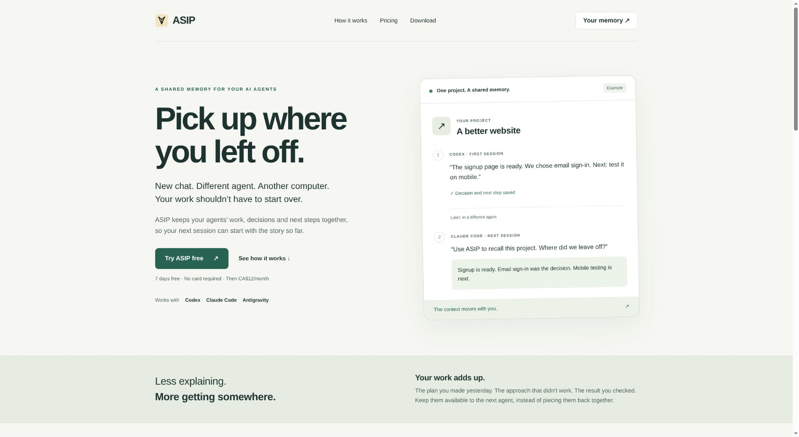
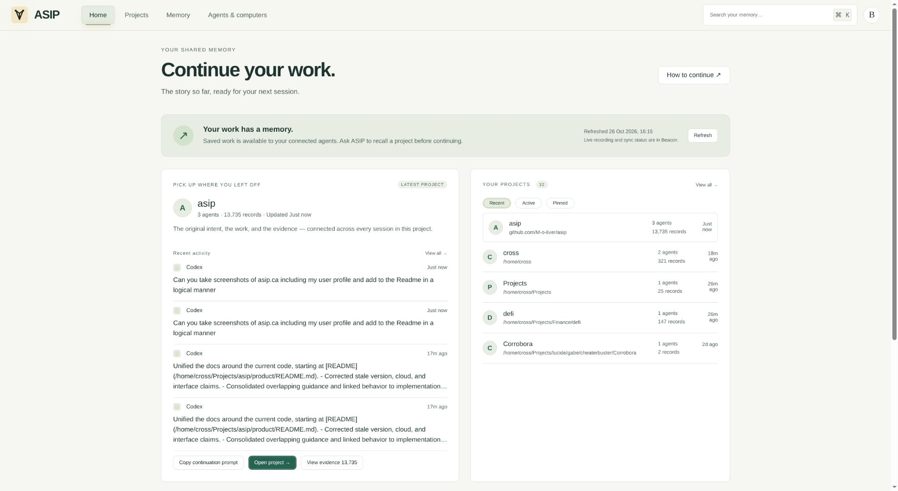
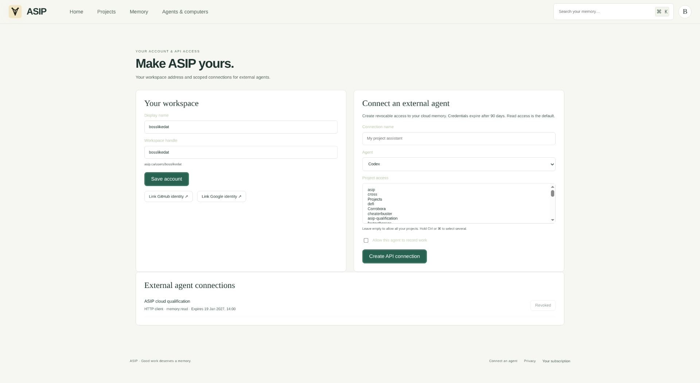

# ASIP

ASIP remembers recorded work across projects, computers, and agent platforms.
Beacon stores activity locally; connected computers can synchronize it to an
ASIP account. Native agent plugins record work, recall history, and call named
API connections. Open ASIP from Beacon to browse the project workspace.

[Website](https://asip.ca) · [Download](https://asip.ca/download) ·
[Install and verify recording](ALPHA.md)

## See ASIP

Screenshots from the live website on October 26, 2026. The signed-in views show
the owner's `bosslikedat` account and its recorded work.

### Start on the website

[asip.ca](https://asip.ca) introduces shared agent memory, explains setup, and
links to Beacon downloads and account sign-in. The handoff card on this page is
labelled as an illustrative example.



### Continue a project

The signed-in home brings recent work, projects, and continuation actions
together. Recorded activity is separate from live device status, which is shown
in Beacon.



<details>
<summary><strong>Profile and scoped agent access</strong></summary>

The account page manages the display name and workspace handle, links sign-in
identities, and creates revocable external-agent connections with project and
write permissions. This capture shows the owner's profile and the connection
form; no credential values are displayed.



</details>

## Documentation

| Guide                                     | Owns                                                         | Implementation                                                                     |
| ----------------------------------------- | ------------------------------------------------------------ | ---------------------------------------------------------------------------------- |
| [Setup](ALPHA.md)                         | Install, connect, verify, troubleshoot                       | [Agent installation](beacon/agent-plugins.mjs), [setup UI](beacon/window.js)       |
| [Architecture](ARCHITECTURE.md)           | Local records, native tools, API credentials, recovery       | [Runtime](beacon/runtime.mjs), [helper](plugin-helper/main.go)                     |
| [Cloud](cloud/README.md)                  | Identity, device approval, sync, scoped API, deployment      | [Worker](cloud/src/worker.mjs), [sync client](beacon/cloud.mjs)                    |
| [Accounts and billing](cloud/SAAS.md)     | Trials, subscriptions, provider configuration, web interface | [Billing](cloud/src/billing.mjs), [web UI](cloud/public/assets/interface.js)       |
| [Qualification history](QUALIFICATION.md) | Dated observations, release receipts, remaining checks       | [Native CI](.github/workflows/beacon.yml), [cloud CI](.github/workflows/cloud.yml) |

Keep behavior in its owning guide and link to it from other guides. Code and
configuration define implemented behavior. Qualification entries describe the
specific source, environment, and date tested; earlier limits remain historical.

## Develop

Run commands from this directory. CI uses Node 24 and Go 1.26.8; see the
[native workflow](.github/workflows/beacon.yml). Installed users need only Beacon
and their agent application.

```sh
npm ci
npm test
npm start
```

`npm test` builds the native helper and plugin bundles before running the Node
tests. `npm start` opens the Electron application. For a separate development
profile, use `npm start -- --user-data-dir=/absolute/path`.

```sh
npm run test:cloud
npm run check:format
npm run cloud:build
```

Cloud tests exercise the Worker in an emulator with disposable D1/R2 data.
`cloud:build` is a dry run. Deployment is a separate operation described in the
[cloud guide](cloud/README.md).

## Package and release

[package.json](package.json) owns the desktop version, build commands, and native
installer targets. [cloud/wrangler.jsonc](cloud/wrangler.jsonc) owns the configured
website download tag and Worker settings. A source version, configured download,
and installed version can differ; check the relevant value before reporting it.

```sh
npm run package
```

Build on the target operating system. Linux produces AppImage, DEB, and RPM;
Windows produces NSIS and ZIP; macOS produces DMG and ZIP. The build includes the
platform's helper, native plugin bundles, and source identity.
Mac builds use an explicit ad-hoc identity (`-`) so the packaged ARM code has a
valid bundle signature without a Developer ID certificate. This is separate
from Apple notarization and normal downloaded-app approval. Mac CI verifies
DMG integrity, copies the app out of the image, verifies its bundle and helper
signatures, runs startup checks on that copy, and checks tamper rejection.
`npm run build:all-helpers` cross-compiles x64/arm64 helpers and bundles; native
installer qualification remains a separate check.

Google desktop sign-in packaging uses
[scripts/configure-signin.mjs](scripts/configure-signin.mjs) with the registered
client JSON supplied through `ASIP_GOOGLE_DESKTOP_CLIENT_JSON`. Keep that file
outside Git. Website OAuth uses separate registrations and Worker secrets.

The native workflow tests and packages Windows, Linux, Apple Silicon Mac, and
Intel Mac. Version tags trigger publication after the native jobs pass;
[scripts/publish-release.mjs](scripts/publish-release.mjs) validates the tag and
publishes installers, qualification receipts, and checksums. Native startup and
fixture tests establish those checks; observed provider sign-in and complete
agent turns belong in the qualification history.

## Boundaries

- Recording requires an authorized native plugin and its required hook review.
  Installation, connection, recording, and cloud sync are distinct states.
- Provider credentials stay in the owning computer's encrypted store. Cloud
  synchronization includes recorded evidence and named API metadata.
- Recovery checkpoints restore local ASIP history. Repository files and the
  operating system have their own recovery mechanisms.
- The former Linux administration services and Fleet implementation are retired.
  Current development uses this product repository.
