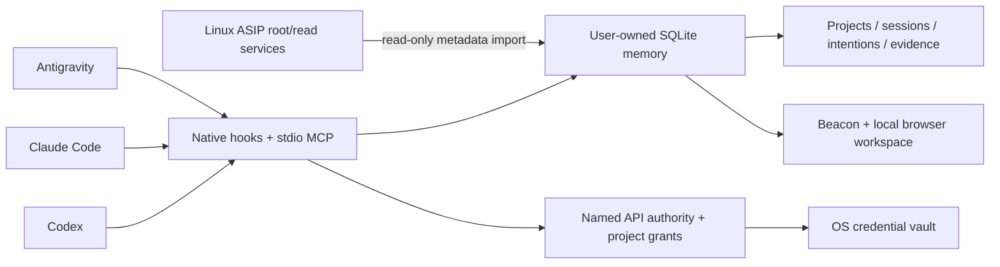

# ASIP 3: the memory of your agents

ASIP separates portable agent memory from Linux machine administration. The
portable service belongs to the login user, and never elevates privileges.
The existing root/read socket services continue to own system operations,
their journal, machine policy, named system credentials and Snapper recovery.

## Why this boundary

Routine coding activity should not depend on root access or a Linux kernel.
SQLite, Python's standard library, local stdio MCP, and a small browser UI are
shared across Windows, macOS and Linux. Agent hooks write directly to the same
database, so collection continues when Beacon is stopped. Beacon is a view and
local operator surface, not the sole collector or a privileged HTTP proxy.

`core/` remains the proven Linux administration adapter. Native Windows/macOS
elevated administration is deliberately not emulated by shelling into a generic
sudo replacement. The portable product works without that adapter.

## Record contract

Sessions retain platform session IDs, agent labels, model metadata, OS account,
first/last observations and state. Platform labels are self-reported; they are
not cryptographic proof of which model performed an action. Hooks inject the
native session ID at SessionStart so explicit MCP intentions join the same
session instead of creating an unrelated conversation.

Intentions have open, held, finished and failed states. Closing an intention
requires a concrete outcome; evidence can contain commit IDs, test results,
paths and references to existing ASIP operations. A held intention may be
resolved explicitly. A terminal intention cannot be silently rewritten.

Events are inserted in `BEGIN IMMEDIATE` transactions with SQLite WAL and FULL
synchronous writes. Each event hashes its contents and the prior event's hash.
`doctor` checks the chain, SQLite integrity and foreign keys. This detects
accidental corruption; it is not tamper-proof against the owning user or root.
Source keys deduplicate exact retries and reject conflicting reuse. Reads use
sequence cursors, not timestamps or UUID ordering.

Hooks retain event/tool names, native IDs, working directories, model names,
hashes of inputs/outputs, explicit failure flags and pointers to platform-owned
transcripts. They never read transcript contents or persist raw tool arguments,
outputs or user prompts. Session boundaries also capture Git HEAD, branch and
bounded filename/status evidence. A tool completion is not automatically a
successful verification. Collection errors create a visible integration failure
record when storage remains available, while preserving the agent's normal flow.

## Project association

1. An explicit project ID is authoritative for that record.
2. A repository remote identifies a project across clones and worktrees. Userinfo,
   tokens, query strings and fragments are removed; SSH/HTTPS remotes normalize
   to the same host/path identity.
3. A repository without an origin uses its canonical local Git root.
4. Non-repository work uses the longest registered containing root.
5. Unknown paths remain unresolved. Multiple Antigravity workspaces are not
   arbitrarily assigned to their first folder; a tool's actual cwd resolves it.

Nested independent repositories get independent identities. The system does
not crawl the home directory or import vendor trees automatically. Explicit
links describe relationships between projects. A session can appear under
several projects because each event has its own association.

Jev is optional, never in the collection path. An explicit `classify` request
sends a sanitized summary plus known project names/descriptions/repository IDs
through a granted `typesafe.jev` authority. The response must contain the exact
candidate set plus an unresolved option, finite probabilities summing to one,
and a consistent choice/confidence. Suggestions require probability and
confidence >= .85 and a .20 margin, remain review records, and do not reassign
events. These thresholds are conservative initial policy, not measured accuracy.

## API access

Authority metadata and project grants live in private local state. Credential
values live in Secret Service/libsecret on Linux, Keychain on macOS or Windows
Credential Manager. Plaintext and third-party fallback keyrings are rejected.
A native backend may be selected from the default keyring's chain. Stored
values never appear in connection lists or audit records.

`access_call` keeps authorization on a fixed provider HTTPS origin and refuses
redirects. It requires a project grant and an open intention. Responses are
bounded to 1MiB and sanitized; request bodies are represented by hashes in
history. `access_use` injects a credential into a finite user process, with
bounded excerpts, output hashes, a deadline and process-group cancellation.
Authorized child processes can still misuse or transform a credential; ASIP is
not a sandbox. OS-account access remains the underlying authority boundary.

GitHub supports OAuth device flow with the user's registered OAuth client.
Google supports Desktop OAuth via a loopback callback, state verification and
PKCE, with refresh material stored in the OS vault. OpenAI, Anthropic and Gemini
support API keys. Subscription sign-ins belong to the native agents; ASIP does
not extract their login stores or repurpose subscription tokens as API keys.
The original root-owned named-authority system stays usable through its existing
administration MCP, with its original authorization and journal.

## Beacon and workspace

Beacon binds only IPv4 loopback, uses a fresh random browser bootstrap token,
then exchanges the URL fragment for an HttpOnly SameSite cookie and clears the
fragment. Exact loopback Host and Origin checks, JSON-only mutations, bounded
requests, CSP and disabled access logging keep the local UI isolated from
ordinary cross-site requests. Local processes with the user's filesystem access
can read its bootstrap file; this is not a multi-user network service.

Projects are the landing view. Repository roots, explicit relationships,
sessions, intentions, history, event hashes, API grants and recovery are
available without a cloud account. The map shows actual registered projects
and explicit links. Recency indicators describe observations, not an invented
live connection guarantee.

Pystray provides Windows/macOS/Linux tray backends. GNOME's stock desktop has
no traditional tray, so the bundled GNOME Shell extension supplies a native
top-bar indicator without requiring AppIndicator. Native startup registration
uses a user systemd service, a macOS LaunchAgent or a Windows Startup launcher.

## Recovery and migration

There are at most ten live memory checkpoint files and manifests. Checkpoints
use SQLite's online backup API, integrity validation and a SHA-256 checksum.
Restore refuses a running Beacon, requires the operator to stop agents, makes
a pre-restore checkpoint, validates the source and restores through SQLite.
Credential values and project files are outside this scope. Existing Linux
Snapper history remains separate; its overview displays at most ten recent
handles without deleting historic audit events or unmanaged system snapshots.

`sync-system` imports registered roots and bounded journal metadata through the
read socket. It leaves the original journal authoritative, excludes raw argv,
output and credentials, retains original IDs/timestamps and deduplicates repeated
imports. Public source and private state never share a Git repository.

## Qualification

The portable unittest suite exercises concurrent persistence, retries,
association, evidence/outcome lifecycle, hook privacy, MCP transport,
configuration merging, API grants, bounded processes, HTTP isolation,
checkpoint retention and restore. GitHub Actions runs the same suite on Linux,
Windows and macOS with Python 3.11 and 3.13. Native desktop interaction and
provider OAuth consent require separate platform/account verification; a green
unit-test matrix alone does not prove them.
